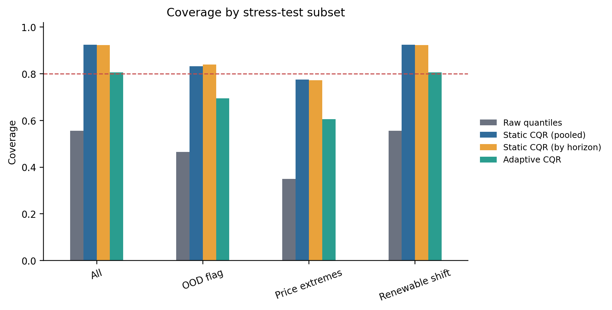
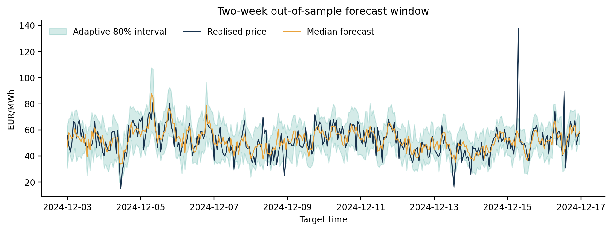

# P1: Probabilistic electricity-price forecasting under regime shift

Corrected local edition v1.1.0 — 18 October 2026

**SIMULATED BENCHMARK — NOT FIELD DATA.** This report concerns a research-training
portfolio, not a named electricity market, employer, Tarim Oilfield or trading system.
The correction, automated tests, new experiments and this release document were
prepared or executed with an AI coding assistant. They are not new evidence of
the applicant's independent personal execution. Original personal records are
preserved separately and describe the earlier v1.0.2 implementation.

## Purpose and experimental design

The question is how raw quantile forecasts, static conformal calibration and a
rolling adaptive wrapper trade coverage against interval width when a simulated
electricity-price process changes regime. This is an implementation and evaluation
exercise using established methods; no new foundational algorithm is proposed.

The simulator produces 420 hourly days from 1 January 2024, with stable, volatile
and renewable-shift regimes. Its 10,080 rows yield 9,888 direct forecast examples
after eight days of history. Chronological issue-day splits contain 247 training,
82 calibration and 83 final-evaluation days. The final 1,992 targets span
3 December 2024–23 February 2025 and all belong to the renewable-shift regime.
The final block is reused for gamma sensitivities and is not an untouched test
set after that exploration.

Seven pooled histogram-gradient-boosting models estimate quantiles .05, .10, .25,
.50, .75, .90 and .95, using horizon as a feature. Each has 140 iterations; row-wise
sorting repairs quantile crossings. Features combine calendar variables, past
price summaries and simulated forecast proxies. Future realised covariates and
regime labels are excluded from model features. Static CQR uses either pooled
calibration scores or separate horizon scores. The adaptive wrapper retains 30
scores per horizon, target miscoverage .20 and reference gamma .015.

## Corrected baseline: seed 20260817

| Method | Coverage | Mean width | Interval score |
| --- | ---: | ---: | ---: |
| Raw quantiles | .556225 | 11.896091 | 34.007247 |
| Static CQR, pooled | .924197 | 27.580914 | 32.176642 |
| Static CQR, by horizon | .923695 | 28.378878 | 33.032735 |
| Adaptive CQR | .806225 | 21.274739 | 30.727504 |

Width is in EUR/MWh. Lower interval score is better. The median model MAE is
6.299118 versus 11.268044 for the seasonal-naive forecast; mean pinball loss is
2.016259. The reported approximate CRPS, 4.501505, integrates only the available
.05–.95 quantile grid and omits the tails; it is not exact full-distribution CRPS.
All methods share the same raw quantiles, so these point/quantile metrics cannot
distinguish interval wrappers. This sample does not establish general superiority.

<!-- PAGE -->

## Why v1.1.0 corrects the conformal calculation

For calibration score `s_i = max(lower_i - y_i, y_i - upper_i)` and `n` finite
scores, set `k = ceil((n+1)*(1-alpha))`. For `1 <= k <= n`, the correction is sorted
score `s_(k)`, indexed `k-1` in code. If `k > n`, the augmented conformal score is
positive infinity and the interval becomes unbounded. Alpha must be finite and
strictly between zero and one. Empty, non-vector or nonfinite scores are rejected.

The old implementation passed `k/n` to `np.quantile(..., method='higher')`.
NumPy maps that probability using `n-1` positions, so this generally selects the
next score. For scores 0–19, alpha .20 gives `k=17`: the correct value is 16,
whereas the old code returns 17. It also capped `k>n` at the largest finite score,
which cannot represent the required augmented infinity. Decimal alpha text is
used for rank arithmetic to avoid `.7` at `n=9` becoming the wrong integer through
binary roundoff; adjacent representable alpha values are tested separately.

The score convention is based on established
[conformalized quantile regression](https://arxiv.org/abs/1905.03222). Its standard
finite-sample coverage justification requires the relevant exchangeability
conditions. Changing the rank does not make those conditions hold in this
dependent, shifted simulator.

## Controlled comparison with preserved Windows v1.0.2

| Method | Old coverage | New coverage | Old width | New width |
| --- | ---: | ---: | ---: | ---: |
| Raw | .556225 | .556225 | 11.896091 | 11.896091 |
| Static pooled | .924197 | .924197 | 27.600691 | 27.580914 |
| Static horizon | .927711 | .923695 | 29.282753 | 28.378878 |
| Adaptive | .826305 | .806225 | 22.362592 | 21.274739 |

The simulator fingerprint and all seven raw quantile columns match exactly across
these two Windows runs. Adaptive interval score changes from 30.906253 to
30.727504. The original Python 3.12 reference is a separate historical run with
raw coverage .547691; it is not mixed into this controlled comparison. The
coverage-width chart now uses a full coverage axis and a regression test checks
that the historical .547691 raw point is visible.

<!-- PAGE -->

## Gamma sensitivity and seed robustness

The reference gamma remains .015. The .030 and .050 runs are exploratory
sensitivities using the same seed, raw model and final block. They are not an
independent basis for selecting a universally optimal adaptation rate.

| Gamma | Adaptive coverage | Mean width | Interval score |
| --- | ---: | ---: | ---: |
| .015 | .806225 | 21.274739 | 30.727504 |
| .030 | .798193 | 21.107557 | 30.833048 |
| .050 | .795181 | 20.784492 | 30.999364 |

Here larger gamma slightly narrows intervals and reduces coverage; the interval
score worsens. The corrected result is more cautious than a claim that faster
adaptation necessarily improves reliability. Static and raw metrics are unchanged
across these gamma runs, as expected.

Two additional simulation seeds use the entire unchanged baseline configuration,
including 420 days, seven quantile models, gamma .015 and all three rolling folds.
Together with the reference they give three baseline market simulations.

| Seed | Raw coverage | Adaptive coverage | Adaptive width | Adaptive score |
| --- | ---: | ---: | ---: | ---: |
| 20260817 | .556225 | .806225 | 21.274739 | 30.727504 |
| 20260818 | .539157 | .814257 | 22.176603 | 32.236669 |
| 20260819 | .558735 | .817269 | 22.474140 | 32.780810 |

Adaptive coverage ranges .806225–.817269 across these three seeds. These runs are
a limited simulator check, not a confidence interval for real-market coverage.
Changing the seed also changes the model's random seed; this experiment does not
separate model stochasticity from simulated-market variation.

## Infinity and clipping are part of the method boundary

The update uses `alpha_next = clip(alpha + gamma*(.20-error), .01, .99)` and a
rolling score distribution. It is inspired by
[Adaptive Conformal Inference](https://arxiv.org/abs/2106.00170), but clipping
changes the unmodified recursion. The usual telescoping argument for that
recursion cannot be transferred to this wrapper without a new analysis.

With 30 scores, an alpha below `1/31` requires an infinite conformal bound. The
code honors that case, and the test suite verifies propagation into adaptive
intervals. In all five completed runs, final-test unbounded fractions are zero.
This observation does not justify replacing future infinities with finite caps.
If an unbounded interval occurs, unconditional mean width and interval score
remain infinite. Explicit `finite_only_mean_width` and `finite_only_interval_score`
columns describe the finite subset only; they do not replace full-sample metrics.

<!-- PAGE -->

## Stress subsets reveal conditional failures

Overall adaptive coverage close to .80 hides much poorer coverage among extremes
and flagged examples. Price extremes are the lower and upper empirical deciles
of the final outcomes, selected retrospectively for evaluation. They are not
issuance-time labels. The OOD flag uses a training-standardised feature-distance
score and a training 95th-percentile threshold; it is a simple diagnostic, not a
validated detector of operational failure.

| Subset | Rows | Raw coverage | Pooled coverage | Adaptive coverage |
| --- | ---: | ---: | ---: | ---: |
| All | 1,992 | .556225 | .924197 | .806225 |
| Price extremes | 400 | .350000 | .775000 | .605000 |
| OOD flag | 131 | .465649 | .832061 | .694656 |

For price extremes, adaptive mean width is 22.455469 and score is 53.229701,
compared with pooled width 29.173814 and score 47.900275. Adaptive calibration
does not dominate pooled calibration on this subset. OOD adaptive width is
22.096972 and score 38.840207. These small, dependent subsets do not support
precise inferential claims.

All final-evaluation rows are renewable-shift examples, so the `Renewable shift`
bar repeats `All`. No volatile-regime row appears in this final subset table;
that absence is not evidence of good volatile-regime performance. The separate
rolling diagnostics below include earlier periods and show substantially lower
coverage in one fold.

## Rolling-origin diagnostic

Each expanding-window fold reserves its last 42 past days for calibration and
evaluates the next 28 days (672 hours). The fit, calibration and evaluation
periods remain chronological. These folds are diagnostics within one constructed
timeline and do not create independent replications.

| Fold | Evaluation start | Raw coverage | Pooled coverage | Adaptive coverage |
| --- | --- | ---: | ---: | ---: |
| 1 | 2024-07-16 | .671131 | .791667 | .805060 |
| 2 | 2024-09-02 | .486607 | .578869 | .720238 |
| 3 | 2024-10-20 | .395833 | .784226 | .808036 |

Fold 2 adaptive coverage is only .720238. Reporting the final .806225 alone would
therefore hide a material reliability failure under a different segment of shift.

<!-- PAGE -->

## Timing and joint uncertainty limitations

The historical code calls the task day-ahead, but daily issue time is midnight
and target horizon 1 is that same midnight. Thus horizon 1 is nowcast-like and
the other targets have lead times 1–23 hours. A claim of operational 24-hour
day-ahead forecasting requires an adapter with a genuine prior issuance cutoff.

Price lags and summary features use past history. Forward fill uses observations
available before issuance; incomplete leading history is rejected rather than
backfilled from future values. Nonetheless, the load, renewable and temperature
forecast proxies are constructed from simulated realised series with added noise.
They are assumed available at issuance and may be more informative than actual
forecasts. There are no publication-vintage or revision records to prove real
availability. This distinction must carry into any downstream scheduling study.

Adaptive buffers are separate by horizon. An earlier horizon's outcome on the
same issue day does not update a later horizon's buffer. A horizon uses earlier
days' outcomes before its next prediction, assuming immediate publication once
the target is observed. Delays, settlement revisions and data outages require an
explicit operational availability model before deployment.

An 80% hourly marginal interval does not imply an 80% chance that all 24 hourly
prices lie inside their intervals. These models do not calibrate a daily maximum
score, a simultaneous band, a temporal copula or joint scenario distribution.
Passing these marginal quantiles or widths into downstream optimisation does not
establish joint price-path calibration, guarantee a dispatch risk level, or prove
that a chosen CVaR objective is calibrated to realised losses.

Row-wise sorting also alters the original fitted quantile functions. Only seven
quantile levels are available; tail shape between and beyond them is not learned
by this report. The simple OOD score ignores temporal structure and feature
correlations. These are concrete directions for validation, not claims of solved
operational risk management.

<!-- PAGE -->

## Reproducibility, provenance and release status

Version metadata and runtime version are both 1.1.0. The original Windows Python
3.13.15 environment was used read-only; NumPy 2.3.5, pandas 2.2.3, SciPy 1.17.0 and
scikit-learn 1.8.0 are recorded in manifests. Bytecode was disabled, plotting cache
was redirected inside this workspace, and the corrected local `src` took priority
over the original environment's editable installation. No original repository,
personal log, Desktop/Downloads artifact or remote repository was modified.

The suite passes 16 tests, including exact discrete indices, alpha boundaries,
ties, nonfinite/invalid inputs, infinity propagation, infinite scores and explicit
conditional diagnostics. A live chart regression includes the old raw .547691
point. Existing checks cover chronological separation, forbidden future features,
leading missing history, horizon separation, and an adaptive interval's independence
from its own outcome. These tests check specific invariants; they are not a proof
against every leakage route or every implementation defect.

Five full corrected experiment runs are saved under `corrected_v110/`: baseline,
gamma .030, gamma .050, and additional baseline seeds 20260818/20260819. Each has
a manifest, four tables, six figures, simulated data and forecast exports.
Assistant terminal logs and unit-test output are in `corrected_v110/logs/`.
`scripts/summarize_release.py` generates machine-readable comparison tables and
checks the retained historical bytes against their original read-only source.
SHA256 identifies local artifacts, not scientific validity or personal authorship.
All 73 retained historical/evidence files match the uploaded v1.0.2 snapshot
extracted under `work/pv18/p1`; the Desktop working repository is a separate
artifact and is used here only for its read-only Python environment.

The baseline CSV has 1,992 rows and includes raw quantiles, pooled/horizon static
bounds, adaptive bounds, alpha, correction and OOD columns. Its data fingerprint
matches the original Windows run. Unmodified v1.0.2 active outputs, experiments,
old report, README and reproduction record are in `historical/v102/`.
Unmodified applicant verification evidence remains in `evidence/` and must be
read as historical. The earlier PDF is not the corrected report.

The corrected findings are narrower than a general performance claim: the rank
defect is repaired and regression-tested; overall adaptive coverage is near .80
in the evaluated final blocks, while stress subsets and one rolling fold fail.
Three simulated seeds do not establish real-market external validity, arbitrary
time-series coverage, or jointly reliable daily paths. A next study would need
real publication vintages, a true issuance gap, delayed-label handling, additional
untouched temporal blocks and an explicitly validated joint uncertainty model.

## Relevant verified primary references

Romano, Y., Patterson, E., and Candès, E. J. (2019).
[Conformalized Quantile Regression](https://arxiv.org/abs/1905.03222).
Source of the quantile-based conformity score and static CQR framework.

Gibbs, I., and Candès, E. (2021).
[Adaptive Conformal Inference Under Distribution Shift](https://arxiv.org/abs/2106.00170).
Source motivating the adaptive update; its guarantees are not asserted for this
clipped, rolling implementation. Both primary-source records were checked on
18 October 2026. This report makes no priority claim beyond the local correction.
